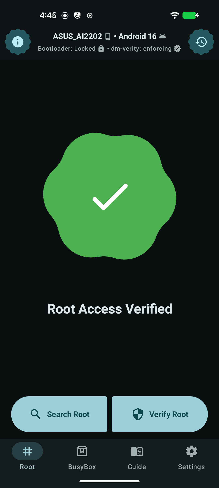

# Script-assisted installation

This method uses `scripts/install_lineage_locked.py` to prepare and flash the images. It requires
less manual work, but it is **not safe to run unattended**. The manual flashing method is described
in [Manual installation](install-manual.md).

## TL;DR

**This erases all data and can leave the phone unrecoverable. Read the warnings below first.**

> **macOS and Windows are untested.** Their instructions have not been tested on a phone. The Linux
> path is the tested one; treat macOS and Windows as experimental.

1. Install the host tools for your platform:

   **Linux** — [full setup](setup.md)

   ```bash
   sudo apt update
   sudo apt install android-tools-adb android-tools-fastboot openssl python3
   ```

   Then install [`payload-dumper-go`](https://github.com/ssut/payload-dumper-go/releases) and put it
   on your `PATH`.

   **macOS** — [full setup](setup-macos.md)

   ```bash
   brew install python openssl@3 payload-dumper-go
   brew install --cask android-platform-tools
   export PATH="$(brew --prefix openssl@3)/bin:$PATH"
   ```

   **Windows** — [full setup](setup-windows.md)

   ```powershell
   winget install --id Python.Python.3.12 -e
   winget install --id Google.PlatformTools -e
   winget install --id ShiningLight.OpenSSL.Light -e
   ```

   Then install `payload-dumper-go` and the USB driver as described in the setup page.

2. Enable USB debugging on the phone, connect it, and run these from the repository root:

   ```bash
   python3 scripts/install_lineage_locked.py doctor
   python3 scripts/install_lineage_locked.py install
   ```

   On Windows, use the `py -3` launcher instead:

   ```powershell
   py -3 scripts/install_lineage_locked.py doctor
   py -3 scripts/install_lineage_locked.py install
   ```

`install` downloads the tested firmware and ROM, builds the images, and flashes the phone. The first
boot can stay black for several minutes.

Back up `zf9/key.pem` afterwards; you need it for restore and future updates. To root, boot LineageOS
and run `python3 scripts/install_lineage_locked.py root` on Linux. On macOS and Windows, patch
`boot.img` in the Magisk app first, then use `root --patched-boot` (see
[Root with Magisk](#root-with-magisk)).

## Before you start

Read the [shared safety warnings, requirements, and file layout](15-install-guide.md). The script
rewrites partitions and attempts to erase userdata. There is no verified EDL unbrick path.

Review these limitations before you run the script:

- Connect only the target phone. The script can select the first live device, including after a
  reboot, even when `--serial` is specified. It warns rather than stops for an unexpected product.
- A failed `fastboot -w` does not stop the script, and the script does not report its result. Do not
  rely on it to confirm the wipe; do not use `--no-wipe` for a first installation.
- The script does not check image provenance or verify every image against its AVB descriptor before
  it flashes. Verify image sources, checksums, compatibility, and the signing chain independently.
- The script uses image file sizes to create logical partitions. Use raw, non-sparse images; the
  file size of a sparse image is not its expanded partition size.
- The script's `restore` command needs the private key that matches the device's `avb_custom_key`,
  plus the Lineage recovery image to build the intermediate recovery chain. Use `--key PATH` if the
  key is not at `<workdir>/key.pem`.
- The script stops if `fastboot -w` fails. Do not continue after a failed wipe.
- `restore`, `install`, and `prepare` can start in fastbootd; the script returns to the bootloader
  when physical partitions are required.
- `--dry-run` does not reliably simulate preparation or device detection. Do not use it as proof
  that a real run will succeed.
- The script does not verify that the firmware and image sets match the phone.

## Download the images

`prepare`, `install`, and `restore` download only the missing images they need:

| Task | Downloads if missing |
|---|---|
| `prepare` | Stock `boot`, `dtbo`, `vendor_boot`, `vbmeta_system`; LineageOS `boot`, `dtbo`, `vendor_boot`, `recovery`, `vbmeta_system`, `vendor`, `odm`, `vendor_dlkm` |
| `install` | The `prepare` stock images and all 11 LineageOS images |
| `restore` | All 12 stock images and the LineageOS recovery image |

Use the `download` command to fetch both sets in advance:

```bash
python3 scripts/install_lineage_locked.py download
```

The command fetches the tested ASUS `.145` firmware and LineageOS ZIPs, verifies both SHA-256
values, extracts `payload.bin` from each, and creates the stock and Lineage images. After extraction,
the script deletes each ZIP and keeps `payload.bin` for later retries. Use `--keep-zip` to keep the
ZIPs, or `--zip-only` to stop after the verified downloads.

Use `--no-download` with `prepare`, `install`, or `restore` to keep the run offline. The command
stops if an image is missing. Use `--force` to download both ZIPs again.

The download steps need `payload-dumper-go`. `doctor` warns if it is missing. Use these options to
select one image set:

- `--stock-only` downloads only the ASUS firmware and stock images.
- `--lineage-only` downloads only the LineageOS ROM and images.

To use different ZIPs, supply their URLs and SHA-256 values:

```bash
python3 scripts/install_lineage_locked.py download \
  --firmware-url <URL> --firmware-sha256 <SHA256> \
  --rom-url <URL> --rom-sha256 <SHA256>
```

The firmware must match the phone. The tested links and hashes are in the
[README](../README.md#downloads).

## Install

Run these commands from the repository root. The script downloads missing images into the
[shared file layout](15-install-guide.md#3-file-layout):

```bash
python3 scripts/install_lineage_locked.py doctor
python3 scripts/install_lineage_locked.py prepare
# Connect the phone (USB debugging enabled), then:
python3 scripts/install_lineage_locked.py install
```

`prepare` downloads missing images unless you use `--no-download`. Back up `zf9/key.pem` securely
after preparation. `install` runs preparation again. `doctor` warns about missing image files but does not necessarily fail; check its output before
continuing. `install` then:

1. Reads the product, lock state, and active slot. It does not enforce the expected product or lock
   state.
2. Flashes the user key to `avb_custom_key`.
3. Stages the stock kernel, Lineage Recovery, and `vbmeta_rec` so recovery can boot.
4. Runs `fastboot -w` to erase userdata and metadata, then reboots to fastbootd.
5. Deletes, creates, and writes the six logical partitions using the Lineage image file sizes.
6. Returns to the bootloader and flashes the Lineage physical boot chain.
7. Reboots the phone.

If `fastboot reboot fastboot` does not reach fastbootd, the script pauses and asks you to select
**Advanced → Reboot to fastbootd** (or **Enter fastboot**) in Lineage Recovery.

After installation, follow the shared [first boot and verification instructions](15-install-guide.md#5-first-boot).

## Root with Magisk

The `root` command follows the [official Magisk installation flow](https://topjohnwu.github.io/Magisk/install.html)
for a device with boot ramdisk: patch `boot.img`, flash the patched image, then install the Magisk
app and complete its additional setup. It also re-signs the top-level `vbmeta` with your AVB key,
because the bootloader stays locked. Verification stays enabled (`--flags 0`); only `boot_<slot>`
and `vbmeta_<slot>` are rewritten, so userdata is kept.

Requirements:

- The original private key that matches `avb_custom_key` (`zf9/key.pem`, or `--key PATH`). The
  command never generates a new key.
- `images/lineage/boot.img` from the same Lineage build that is installed.
- Magisk v27 or newer. On Linux, `root` downloads the latest official APK to `zf9/downloads/` by
  default; pass `--magisk-apk PATH` to use a specific APK instead. On macOS and Windows, use the
  Magisk app on the phone (see [Patch on the phone](#patch-on-the-phone-windows-and-macos)).
- LineageOS must be running with USB debugging enabled. Before patching anything, `root` checks the
  running OS over adb and refuses to flash a phone that does not report LineageOS.

Boot LineageOS, enable USB debugging, and connect the phone. The command verifies the running OS,
then reboots the phone to the bootloader itself. It cannot verify a phone that is only in the
bootloader or fastbootd:

```bash
python3 scripts/install_lineage_locked.py root
```

The script:

1. Verifies that the running Android is LineageOS.
2. On Linux, runs Magisk's own `boot_patch.sh` against this device's `boot.img` with the device's
   pre-init partition. With `--patched-boot`, it uses the image supplied instead.
3. Computes a new AVB hash descriptor for the patched image and rebuilds `vbmeta_lineage`.
4. Installs the Magisk app over adb when the phone is reachable and also copies the APK to
   `/sdcard/Download/`.
5. Flashes `boot_<slot>` and `vbmeta_<slot>` and reboots.

### Patch on the phone (Windows and macOS)

Native host patching runs a Linux `magiskboot` binary from the Magisk APK, so the plain `root`
command only works on Linux. On macOS and Windows, let the Magisk app patch the image, then flash it
with `--patched-boot`.

1. Install the Magisk app on the phone (the official APK from the
   [Magisk releases](https://github.com/topjohnwu/Magisk/releases), or an APK already in
   `zf9/downloads/`). Enable USB debugging.
2. Copy the installed build's boot image to the phone:

   ```bash
   adb push zf9/images/lineage/boot.img /sdcard/Download/boot.img
   ```

3. In the Magisk app, tap **Install → Select and Patch a File**, choose
   `/sdcard/Download/boot.img`, and let it finish. It writes a `magisk_patched-*.img` file to
   `/sdcard/Download/`.
4. Copy the patched image back:

   ```bash
   adb shell ls /sdcard/Download/magisk_patched-*.img
   adb pull /sdcard/Download/magisk_patched-XXXXX.img zf9/boot_magisk.img
   ```

5. Flash it. The script still checks that LineageOS is running, rebuilds `vbmeta_lineage` with your
   key, and flashes both partitions:

   ```bash
   python3 scripts/install_lineage_locked.py root --patched-boot zf9/boot_magisk.img
   ```

   On Windows use `py -3` and a PowerShell path:

   ```powershell
   py -3 scripts/install_lineage_locked.py root --patched-boot .\zf9\boot_magisk.img
   ```

`--patched-boot` does not install the Magisk app; the phone already has it. Pass `--magisk-apk PATH`
if you also want the script to install or push an APK. `--preinit-device` is not valid with
`--patched-boot`, because the phone's Magisk app chose the pre-init device when it patched the image.

### Finish Magisk setup

After the phone boots, open the **Magisk** app, tap **Reinstall** on the Magisk card, and choose
the **recommended** option. Let it finish and approve the reboot it asks for. Magisk is not fully
usable until that step completes.

If the app is not installed (for example, the phone was in the bootloader and had no adb), install
it manually:

```bash
adb install -r zf9/downloads/Magisk-v31.1.apk
```

or copy that APK to the phone and open it from Files. The script also leaves a copy at
`/sdcard/Download/` when adb was available.

Check the Magisk home screen afterwards: it should show the installed version (for example
`31.1`). If it still says “Not installed”, the patched boot image did not boot; check the active
slot and rerun `root`.

### Verify root

Magisk's Home card should say **Installed**. To verify from another app, grant it superuser access
and run its root check. On the tested phone, Root Checker reports root access while the bootloader
stays locked and dm-verity stays enforcing:




On Linux, the script patches `boot.img` on the host with Magisk’s official `boot_patch.sh`, using
this device’s own image and pre-init partition. On macOS and Windows, `--patched-boot` uses an image
patched on the phone instead. In both cases, do not copy `boot_magisk.img` to another phone or reuse
it after a ROM update. Also do not run the guide’s
`fastboot flash vbmeta --disable-verity --disable-verification` step: this install relies on a
locked bootloader with verification enabled, and the script re-signs `vbmeta` instead.

To build the images without touching the phone:

```bash
python3 scripts/install_lineage_locked.py root --patch-only --magisk-apk Magisk-v31.1.apk
```

On macOS and Windows, pass the image that the Magisk app already patched:

```bash
python3 scripts/install_lineage_locked.py root --patch-only --patched-boot zf9/boot_magisk.img
```

`--patch-only` does not contact the phone, so it skips the LineageOS check and cannot flash
anything. Without `--patched-boot`, the artifacts are `zf9/out/boot_magisk.img` and
`zf9/out/vbmeta_lineage.img`. With `--patched-boot`, the boot image is the file you supplied and the
command only writes `zf9/out/vbmeta_lineage.img`. Use `--no-download` to stop instead of downloading
missing images, or `--preinit-device PATH` if a future Magisk version needs a different pre-init
partition (the default is `/dev/block/by-name/metadata`).

Limitations:

- Root is lost when a ROM image is reflashed or restored; run `root` again afterwards.
- A wrong key in `avb_custom_key` makes the phone fail verification. Keep `key.pem` backed up.
- Play Integrity and some banking or wallet apps may fail. The boot state is `yellow` with the
  custom key, and Magisk itself is detectable.
- If the phone does not boot after rooting, use `unroot` below.

## Remove root

Run this with the phone in LineageOS (USB debugging enabled), fastbootd, or the bootloader. The
script moves it to the bootloader itself when it can:

```bash
python3 scripts/install_lineage_locked.py unroot
```

`unroot` flashes the original Lineage `boot` and a freshly signed `vbmeta`; it does not erase data.
Magisk's `/data/adb` files remain but are inactive. A data wipe or `restore` removes them.
